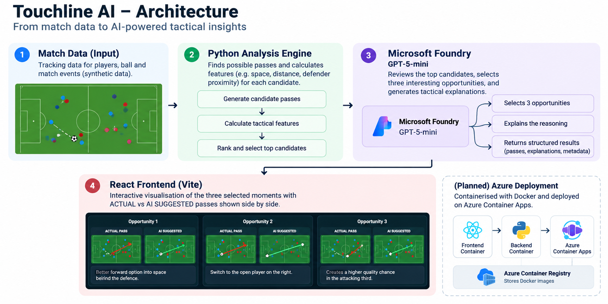

# Touchline AI — See the Game Differently

**What if AI could spot the passing opportunities players missed?**

https://github.com/user-attachments/assets/2d613400-e277-4166-89a0-f5e144ccdf1a

## What is Touchline AI?

Touchline AI finds interesting passing opportunities in football tracking data and shows **the actual pass** alongside **an alternative suggested by AI**.

## How it works

1. **Python finds possible passes.** It scans player and ball positions and measures factors like space and nearby defenders.
2. **Microsoft Foundry AI picks the moments.** GPT-5-mini selects three interesting opportunities and explains its reasoning.
3. **React shows the difference.** Compare **ACTUAL** and **AI SUGGESTED** passes side by side.

## Architecture



**Tech stack:** React + Vite · Python · Microsoft Foundry (GPT-5-mini) · Docker

**Cloud deployment:** Azure Container Apps is the planned hosting architecture. The Python backend image was built and pushed to Azure Container Registry; the complete app is **not yet publicly deployed**.

## Run locally

Create a `.env` file in the project root:

```dotenv
AZURE_OPENAI_ENDPOINT=your_foundry_endpoint
AZURE_OPENAI_API_KEY=your_api_key
AZURE_OPENAI_DEPLOYMENT=your_deployment_name
```

Then run:

```bash
docker compose up --build
```

Open the frontend address shown by Docker Compose.

> **Note:** This prototype uses synthetic match tracking data. Its passing recommendations are tactical possibilities, not guaranteed better outcomes.

---

**Touchline AI — See the game differently.**
